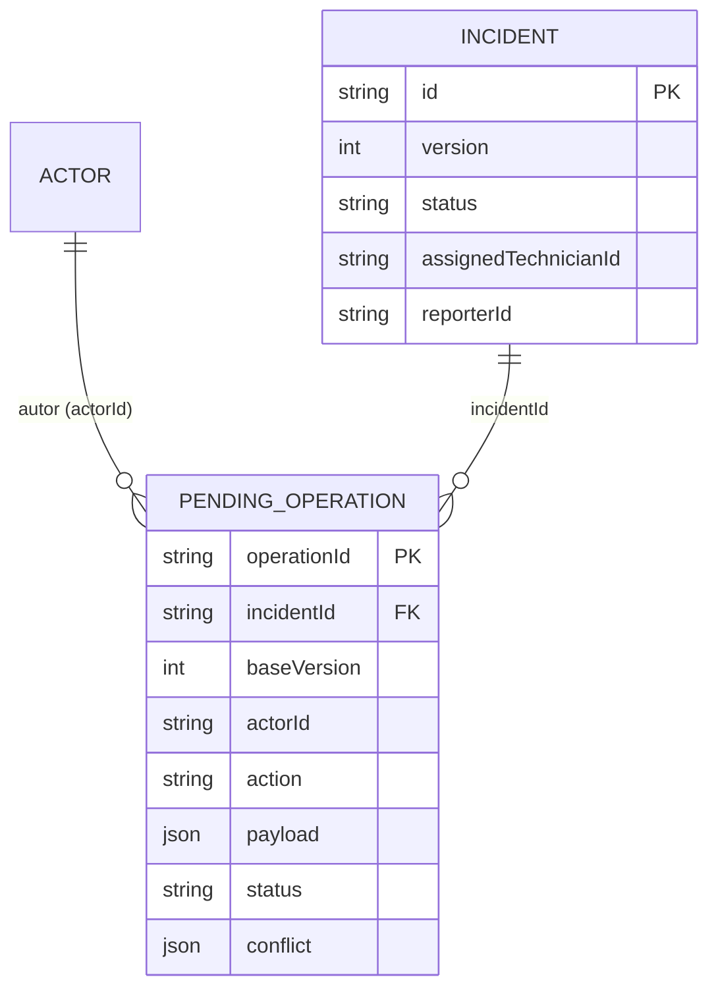

# Modelo de datos local — CampusOps (semana 08)

Alcance: persistencia local sin conexión, cola de operaciones pendientes, migración de esquema y recuperación. Todos los datos son ficticios (actores `reporter-1`, `technician-1`, `technician-2`, `coordinator-1`; incidencia `campus-inc-001`, versión 1, asignada a `technician-1`).

Código: [`src/domain/offlineModel.ts`](../src/domain/offlineModel.ts), [`src/infrastructure/keyValueStorage.ts`](../src/infrastructure/keyValueStorage.ts), [`src/infrastructure/migrations.ts`](../src/infrastructure/migrations.ts), [`src/infrastructure/localDatabase.ts`](../src/infrastructure/localDatabase.ts).
Pruebas: [`course-tests/team/week-08-persistence.test.ts`](../course-tests/team/week-08-persistence.test.ts).

## Qué se guarda y dónde

| Dato | Dónde | Sensibilidad |
|---|---|---|
| Copia local de incidencias (`StoredIncident`) | Documento v2, clave `campusops.db.v2` en AsyncStorage | Datos ficticios; se sanitizan antes de registrarse (`redactForTelemetry`) |
| Cola de operaciones pendientes (`PendingOperation`) | Mismo documento v2 | Notas y referencias de foto: no se escriben en logs |
| Tokens y sesión | `expo-secure-store` (semana 4/6) | **No** se mezclan con este documento |
| Fotografías | Sólo una **referencia** (`localUri`) marcada `uploaded: false` | Una referencia no prueba que la imagen se subió |

**Almacenamiento elegido: AsyncStorage con un único documento JSON versionado.** Decisión y alternativas en [`evidence/week-08/engineering.json`](../evidence/week-08/engineering.json). Razón principal: `setItem` de una clave es atómico, de modo que el documento completo (incidencias + cola) cambia de estado en una sola escritura y nunca queda un esquema mezclado. Un puerto `KeyValueStorage` aísla el adaptador; las pruebas usan un adaptador en disco para simular cierre y reapertura.

SecureStore no se usa para la cola porque su límite de tamaño por valor es reducido y la cola crece; sí se conserva para tokens.

## Versión de esquema

| Versión | Disposición | Estado |
|---|---|---|
| **v1** (anterior) | Dos claves: `campusops.incidents` (arreglo) y `campusops.queue` (arreglo con `id`, `author`, `kind`, `text`, `photoUri`) | Sólo se lee para migrar |
| **v2** (actual) | Una clave `campusops.db.v2`: `{ schemaVersion: 2, incidents[], queue[] }` | Vigente (`SCHEMA_VERSION = 2`) |

## Entidades y relaciones



- Una incidencia tiene 0..n operaciones pendientes; cada operación pertenece a una sola incidencia y a un solo autor.
- `baseVersion` es la versión de la incidencia que el autor conocía al crear la operación; es la referencia de la comparación en tres vías de la sincronización ([`docs/sync-policy.md`](sync-policy.md)).

## Estructura de la cola

| Campo | Tipo | Regla |
|---|---|---|
| `operationId` | texto | Estable: se crea una vez; el reintento y el reinicio no lo cambian. Único en la cola. Es la clave de idempotencia (`Idempotency-Key`) |
| `incidentId` | texto | Debe existir localmente al encolar |
| `actorId` | texto | Autor. Se valida con `canPerform` (semana 6): un técnico sólo encola sobre incidencias asignadas a él |
| `baseVersion` | entero | Versión local de la incidencia al encolar |
| `action` | `start` \| `comment` \| `add_evidence` \| `resolve` | Contrato público |
| `payload` | objeto | `comment`: `{text}`; `resolve`: `{diagnosis}`; `add_evidence`: `{evidenceId, localUri, uploaded:false}` |
| `createdAt` | ISO 8601 | Orden de aplicación |
| `status` | `pending` \| `conflict` | `conflict` conserva la operación íntegra más `conflict {fields, remoteVersion, detectedAt}` |

Reglas de integridad implementadas en `localDatabase.ts`:

1. **Mismo `operationId` + mismo contenido** → reintento: no se duplica (`created: false`).
2. **Mismo `operationId` + contenido distinto** → error `operation_id_reuse`; la cola no cambia.
3. `removeConfirmed(ids)` retira **sólo** las operaciones confirmadas por el servidor. Un error, timeout o conflicto no autoriza descartar (`markConflict` conserva la operación).
4. `saveIncidents` actualiza la copia del servidor y **nunca** modifica la cola.
5. Las mutaciones se serializan (cola de promesas) y cada una escribe el documento completo en una sola clave.
6. Un documento ilegible **no** se reemplaza por uno vacío: se informa el error.

## Migración v1 → v2 y recuperación

La clave `campusops.db.v2` es el **punto de confirmación (commit)**. Los datos v1 no se modifican hasta que v2 está escrito y se relee válido.

```text
leer v1 (2 claves) → transformar en memoria → escribir v2 (COMMIT) → releer y verificar → borrar v1
```

| Falla inyectada | Estado tras la falla | Al reabrir |
|---|---|---|
| `mid-transform` (a mitad de la cola) | Sólo v1 completo; no existe clave v2 | Migra con éxito (`migrated`) |
| `before-commit` | Sólo v1 completo; no existe clave v2 | Migra con éxito (`migrated`) |
| `after-commit` | v2 íntegro + restos v1 | Detecta v2 válido, borra restos (`cleaned-after-commit`), sin duplicar |
| v2 ilegible con v1 presente | — | Descarta v2 y vuelve a migrar (`discarded-unreadable-v2`) |
| v2 ilegible sin v1 | — | Error `unrecoverable_store`; no se borra nada |
| v1 ilegible | — | Error `legacy_unreadable`; no se borra nada |

Transformación de campos: `id → operationId` (se conserva), `author → actorId`, `kind: note → comment {text}`, `photo → add_evidence {evidenceId:'pending:<id>', localUri, uploaded:false}`, `start`/`resolve` igual. Sin `baseVersion` se usa la versión de la incidencia (o 1). Las incidencias sin `version` reciben 1.

Procedimiento manual de recuperación: reabrir la app ejecuta `ensureCurrentSchema` automáticamente; no hay que borrar datos a mano. Los estados antes / tras la falla / tras recuperar quedan registrados en [`reports/week-08/migration-tests.json`](../reports/week-08/migration-tests.json).

## Límites conocidos (honestos)

- La referencia de fotografía todavía apunta a un archivo en caché. Copiarla a almacenamiento persistente de la app y subirla es trabajo de la semana 12; hoy se conserva como recurso pendiente, nunca como subido.
- AsyncStorage no cifra: por eso tokens siguen en SecureStore y los logs pasan por `redactForTelemetry`.
- La conexión de la cola con la sincronización real (`resolveSync`, `deduplicateOperations`, reintento con el servidor) corresponde a [`docs/sync-policy.md`](sync-policy.md) y a la prueba de extremo a extremo del cierre.
